  

# 🤖🎥 Awesome Video AI & Real-Time Vision Agents

### ⚡ Low-Latency Multimodal Vision Streams • WebRTC AI Agents • Real-Time VLM Understanding • Edge Vision Inference 🚀

---

## 📌 Overview & SEO Summary 🌐

Welcome to the definitive, curated directory of **Video AI & Real-Time Vision Agents**! 🌟 This repository indexes production-ready **SaaS platforms**, enterprise vision infrastructures, and breakthrough **open-source AI vision agent frameworks**.

Engineered for **AI Agent Developers**, **Computer Vision Engineers**, **Robotics Architects**, and **Streaming Infrastructure Teams**, this ecosystem showcases tools that:
- 🚀 **Orchestrate Real-Time Multimodal Voice & Vision Agents**: Full-duplex audio/video streams over WebRTC and WebSockets.
- 👁️ **Execute Vision-Language Model (VLM) Video Ingestion**: Sub-second temporal visual QA, video summarization, and scene grounding (Qwen2.5-VL, LLaVA, MiniCPM-V, VideoLLaMA 3).
- ⚡ **Deliver Ultra-Fast Edge & Stream Object Detection**: Zero-latency tracking with YOLO, RF-DETR, SAM 2, and MediaPipe at 60–120+ FPS.
- 🔍 **Index Long-Form Video for Semantic Vector Search**: Natural language video retrieval, temporal event detection, and multi-camera spatial search.
- 🛡️ **Deploy Autonomous Edge NVR & Camera Security**: Intelligent self-hosted NVR solutions like Frigate, Scrypted, and Viseron powered by TensorRT, Coral TPU, and OpenVINO.

---

## 📑 Table of Contents 🧭

- [📊 Sector Overview & Market Dynamics](#-sector-overview--market-dynamics)
- [🏢 SaaS & Managed Enterprise Platforms](#-saas--managed-enterprise-platforms)
- [💻 Open-Source GitHub Projects](#-open-source-github-projects)
- [📈 Star History](#-star-history)
- [🤝 How to Contribute](#-how-to-contribute)
- [💖 Support & Sponsorship](#-support--sponsorship)
- [📄 Disclaimer](#-disclaimer)

---

## 📊 Sector Overview & Market Dynamics 📈

The global video analytics and intelligent vision AI agent market is valued at **$13.1 Billion** in 2025–2026 and is projected to expand beyond **$37.8 Billion by 2030–2031** at a compound annual growth rate (CAGR) of over **20.1%**. 

The sector remains **highly fragmented** rather than concentrated or winner-take-all, shaped by diverse deployment topologies across edge IoT cameras and cloud clusters, specialized vertical demands (smart cities, industrial robotics, retail intelligence, defense, and live agentic customer assistants), and rapid open-source VLM breakthroughs that continually empower new agile challengers alongside cloud hyperscalers.

---

## 🏢 SaaS & Managed Enterprise Platforms ☁️

The following curated SaaS platforms provide hosted APIs, edge orchestration, and enterprise foundations for real-time video understanding. Sorted by company scale (valuation / funding / ARR in descending order):

| 🏢 Platform | 💰 Pricing (Starting Tier) | 🎁 Free Tier Limit / Trial | 📈 Company Scale (Valuation / Revenue) | 🎯 Core Focus & Capabilities |
| :--- | :--- | :--- | :--- | :--- |
| **[Clarifai](https://clarifai.com)** | **$30 / month** (Essential Tier; Pay-As-You-Go overage) | **Free Forever Tier**: 1,000 operations/API calls/month, 1,000 inputs, 1 app | **$500M+ Valuation** (~$101M raised, ~$16M ARR) | Full-stack cloud AI platform offering real-time video stream analysis, foundation models, and vector search. |
| **[Encord](https://encord.com)** | **$120 / month** (Starter Tier; billed annually) | **14-Day Free Trial**: Full platform sandbox access up to 5,000 files/labels | **$550M Valuation** ($110M raised via Series C) | Multimodal AI data engine and active-learning platform for automated video labeling and model evaluation. |
| **[Landing AI (LandingLens)](https://landing.ai)** | **$39 / month** (Starter Tier; non-commercial to commercial) | **Free Forever Tier**: 1,000 credits/month (1 credit = 1 image train or inference) | **$250M–$500M Est. Valuation** ($57M raised via Series A) | Visual AI platform by Andrew Ng for industrial inspection, real-time camera defect detection, and edge inference. |
| **[Twelve Labs](https://twelvelabs.io)** | **$29 / month** (Plus Tier; Pro at $99/mo) | **Free Forever Tier**: Up to 3 GB video indexing storage (~600 min equivalent) | **$300M+ Est. Valuation** ($207M raised via Series B) | Cloud video foundation models (Marengo & Pegasus) for semantic video search, temporal localization, and text generation. |
| **[Roboflow](https://roboflow.com)** | **$39 / month** (Starter Credit Pack; pay-as-you-go) | **Free Forever Tier**: 10 recurring credits/month (~80k cloud inferences or 10k auto-labels) | **$200M–$250M Est. Valuation** ($63.6M raised via Series B) | End-to-end computer vision platform offering live RTSP/WebRTC pipelines, supervision toolkits, and edge deployments. |
| **[V7 Labs](https://v7labs.com)** | **$150 / user / month** (Darwin Core Tier; annual billing) | **14-Day Free Trial**: 1,000 image/video frame credits and full workflow access | **$100M Valuation** ($43.3M raised via Series B) | Automated video annotation and multimodal AI workflow platform featuring auto-tracking and high-throughput visual data ops. |
| **[Stream Video & Vision AI (GetStream.io)](https://getstream.io)** | **$0.30 / 1,000 participant min** (Video PayG; Chat starts $399/mo) | **Free Forever Tier**: $100 recurring video credit/mo + 10k MAU free tier for Chat | **$150M+ Est. Valuation** ($58M raised via Series B) | Global low-latency WebRTC video/audio edge infrastructure powering real-time conversational vision agents. |
| **[viso.ai (Viso Suite)](https://viso.ai)** | **$25 / month** (Viso Now Pro; Enterprise workspace custom) | **Free Forever Tier**: 30 recurring daily generation credits/month + free VisoLabel | **$40M–$60M Est. Valuation** (~$9.5M raised via Accel Seed) | End-to-end computer vision infrastructure platform for deploying and scaling real-time video analytics across edge hardware. |
| **[AlwaysAI](https://alwaysai.co)** | **$99 / month** (Developer Core Tier; edge runtime licensing) | **14-Day Free Trial**: Full access to model catalog, CLI, and local deployment | **$30M–$50M Est. Valuation** ($15.6M raised) | Edge computer vision platform enabling teams to build, train, and run real-time video analytics on smart cameras. |
| **[Chooch AI](https://chooch.com)** | **$99 / month** (Developer Sandbox API Tier; Enterprise custom) | **30-Day Free Trial**: Vision Studio sandbox with 500 test stream inferences | **$50M–$75M Est. Valuation** ($25.8M raised) | Enterprise edge-to-cloud computer vision and VLM platform for live video stream monitoring and workplace safety alerts. |
| **[Plainsight](https://plainsight.ai)** | **$499 / month** (Pilot Base Tier; multi-camera production custom) | **14-Day Free Trial**: Managed pilot sandbox with sample video ingestion | **$25M–$40M Est. Valuation** ($12M raised) | Enterprise vision AI platform converting live camera feeds into structured operational intelligence and automated workflows. |

---

## 💻 Open-Source GitHub Projects 🛠️

The following open-source frameworks, models, inference engines, and tools power modern real-time vision agents and video pipelines. **Sorted in descending order by GitHub_Stars**:

| 📦 Repository | ⭐ Stars_Badge | 📜 License | 💡 Architecture & Key Features |
| :--- | :---: | :---: | :--- |
| **[vLLM](https://github.com/vllm-project/vllm)** |  | Apache-2.0 | Ultra-high-throughput, memory-efficient LLM & VLM serving engine supporting continuous batching and multi-image/video input. |
| **[OpenCV](https://github.com/opencv/opencv)** |  | Apache-2.0 | Foundational real-time computer vision library powering camera stream capture, hardware codecs, optical flow, and image math. |
| **[Ultralytics YOLO](https://github.com/ultralytics/ultralytics)** |  | AGPL-3.0 / Commercial | Gold-standard real-time object detection, segmentation, and tracking framework achieving 100+ FPS on edge hardware. |
| **[Roboflow Supervision](https://github.com/roboflow/supervision)** |  | MIT | Modular computer vision toolkit for ByteTrack tracking, polygon zone counting, detections filtering, and video annotators. |
| **[Frigate NVR](https://github.com/blakeblackshear/frigate)** |  | AGPL-3.0 | Real-time AI NVR designed for RTSP IP cameras with local hardware acceleration (Coral, TensorRT, OpenVINO) and semantic search. |
| **[Google MediaPipe](https://github.com/google-ai-edge/mediapipe)** |  | Apache-2.0 | Cross-platform on-device machine learning framework for live hand, pose, face mesh, and object tracking pipelines. |
| **[Detectron2](https://github.com/facebookresearch/detectron2)** |  | Apache-2.0 | Meta's modular visual detection library powering state-of-the-art dense instance segmentation and video mask prediction. |
| **[MMDetection](https://github.com/open-mmlab/mmdetection)** |  | Apache-2.0 | OpenMMLab's modular object detection and instance segmentation toolbox featuring dozens of benchmarked detector backbones. |
| **[MiniCPM-V](https://github.com/OpenBMB/MiniCPM-V)** |  | Apache-2.0 | Edge-optimized open-weight omni-modal VLM capable of live video stream conversation and real-time visual reasoning on consumer GPUs. |
| **[LLaVA](https://github.com/haotian-liu/LLaVA)** |  | Apache-2.0 | Visual instruction-tuned foundation model pioneer with video/image extensions for conversational real-time scene understanding. |
| **[Darknet](https://github.com/AlexeyAB/darknet)** |  | Open-Source | Legendary C/CUDA neural network framework famous for raw-speed real-time YOLOv4/YOLOv3 video object detection. |
| **[SAM 2 (Segment Anything 2)](https://github.com/facebookresearch/sam2)** |  | Apache-2.0 | Meta's foundation model for promptable visual object segmentation and real-time zero-shot mask tracking across continuous video frames. |
| **[Pipecat](https://github.com/pipecat-ai/pipecat)** |  | BSD-2-Clause | Framework for real-time voice and multimodal vision agents over WebRTC/WebSockets, syncing live camera frames with conversational AI. |
| **[LiveKit Agents](https://github.com/livekit/agents)** |  | Apache-2.0 | Production-grade framework for building real-time multimodal voice and vision agents over low-latency LiveKit WebRTC sessions. |
| **[PaddleDetection](https://github.com/PaddlePaddle/PaddleDetection)** |  | Apache-2.0 | End-to-end object detection development kit with high-speed PP-YOLOE and PP-PicoDet models tuned for real-time video deployment. |
| **[TEN Framework](https://github.com/TEN-framework/ten-framework)** |  | Apache-2.0 | Real-time multimodal conversational agent framework supporting full-duplex speech and live video stream perception. |
| **[Grounding DINO](https://github.com/IDEA-Research/GroundingDINO)** |  | Apache-2.0 | Open-set real-time object detector combining DINO with language pre-training to detect any arbitrary visual concept from text prompts. |
| **[RF-DETR](https://github.com/roboflow/rf-detr)** |  | Apache-2.0 | State-of-the-art real-time Detection Transformer by Roboflow delivering sub-10ms inference latency for live video agents. |
| **[InternVL](https://github.com/OpenGVLab/InternVL)** |  | Apache-2.0 | SOTA open-source multimodal vision-language model excelling at multi-frame video understanding, dense captioning, and visual QA. |
| **[YOLO Tracking (BoxMOT)](https://github.com/mikel-brostrom/yolo_tracking)** |  | AGPL-3.0 | Real-time multi-object tracking library implementing ByteTrack, BoT-SORT, DeepOCSORT, and StrongSORT for live camera video. |
| **[MMPose](https://github.com/open-mmlab/mmpose)** |  | Apache-2.0 | Open-source real-time human and animal pose estimation toolkit supporting multi-person 2D/3D skeletal keypoint tracking. |
| **[Qwen-VL](https://github.com/QwenLM/Qwen-VL)** |  | Apache-2.0 | Alibaba Cloud's flagship open-weight VLM series supporting multi-lingual visual QA, dynamic FPS video understanding, and GUI agents. |
| **[CogVLM](https://github.com/THUDM/CogVLM)** |  | Apache-2.0 | Powerful open visual language model featuring deep visual-linguistic fusion for fine-grained image/video grounding and reasoning. |
| **[Scrypted](https://github.com/koush/scrypted)** |  | LGPL-3.0 | Ultra-low-latency video integration and smart camera NVR platform offering hardware-accelerated WebRTC streaming and AI detection. |
| **[Co-Tracker](https://github.com/facebookresearch/co-tracker)** |  | CC-BY-NC-4.0 | Meta's model for tracking any point through long videos, maintaining tracking through occlusions and extreme motion. |
| **[SuperGradients](https://github.com/Deci-AI/super-gradients)** |  | Apache-2.0 | High-performance computer vision training library home to the ultra-fast YOLO-NAS real-time object detection architecture. |
| **[Viseron](https://github.com/roflcoopter/viseron)** |  | GPL-3.0 | Self-hosted open-source NVR providing object detection, facial recognition, and license plate reading on live camera feeds. |
| **[GStreamer](https://github.com/GStreamer/gstreamer)** |  | LGPL-2.1 | Industry-standard multimedia pipeline framework linking RTSP/WebRTC streams directly to hardware decoders and AI plugins. |
| **[Infinity](https://github.com/michaelfeil/infinity)** |  | MIT | High-throughput embedding inference server serving CLIP and SigLIP models to power self-hosted semantic video search. |
| **[Roboflow Inference](https://github.com/roboflow/inference)** |  | Apache-2.0 | Production computer vision inference server supporting real-time RTSP/WebRTC pipelines, YOLO, Florence-2, and SAM 2. |
| **[DeepStream Python Apps](https://github.com/NVIDIA-AI-IOT/deepstream_python_apps)** |  | MIT | NVIDIA GStreamer reference applications for high-throughput multi-stream video analytics on GPUs and Jetson platforms. |
| **[VideoLLaMA 3](https://github.com/DAMO-NLP-SG/VideoLLaMA3)** |  | Apache-2.0 | Frontier open-source video-centric multimodal model designed for high-frame-rate video understanding and temporal reasoning. |
| **[Live VLM WebUI](https://github.com/NVIDIA-AI-IOT/live-vlm-webui)** |  | Apache-2.0 | NVIDIA open-source webcam and WebRTC interface benchmarking live Vision-Language Models with sub-second latency tracking. |
| **[Vision Agents](https://github.com/GetStream/vision-agents-sales-assistant-demo)** |  | Apache-2.0 | Real-time multimodal voice and vision AI agent framework combining YOLO and VLMs over ultra-low-latency WebRTC streams. |

---

## 📈 Star History 🌟

---

## 🤝 How to Contribute 💡

We welcome contributions from the global AI and computer vision community! 🚀

1. 🍴 **Fork the repository** to your personal GitHub account.
2. 🌿 **Create a feature branch**: `git checkout -b feature/add-new-vision-agent`.
3. 📝 **Add your project or platform**:
   - Ensure the project is active, well-maintained, and relevant to real-time video AI / vision agents.
   - Maintain the existing tabular schema (Pricing, Free limits, Badges, and Descriptions).
4. 🧪 **Check formatting and links**: Ensure all Markdown anchors, SVG badges, and hyperlinks are valid.
5. 📬 **Submit a Pull Request**: Provide a concise summary of the addition and why it benefits the ecosystem.

---

## 💖 Support & Sponsorship ☕

If you found this curated ecosystem helpful in building or researching real-time video AI pipelines, consider supporting our ongoing maintenance:

- ⭐ **Star this repository** to help others discover it.
- 🍴 **Fork and share** it with your developer network.
- ☕ **Buy us a coffee / sponsor ongoing curation**: Support development directly via the [GitHub Sponsor Dashboard](https://github.com/sponsors/ishandutta2007).

Your support enables us to keep this directory up-to-date with the fastest-moving developments across multimodal AI, WebRTC streaming, and edge vision models! Thank you! 🙏❤️

---

## 📄 Disclaimer ⚖️

This repository is maintained for educational, research, and technical evaluation purposes. All product names, logos, trademarks, and registered trademarks belong to their respective owners. Mention of commercial products or open-source repositories does not constitute an endorsement. Pricing plans, free tier quotas, and corporate metrics are sourced from publicly available information and are subject to change by their respective providers.
